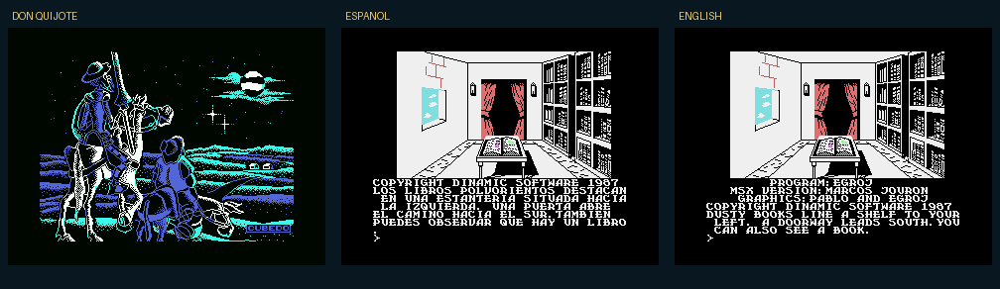

# Don Quijote / Don Quixote — MSX1 + OPL4

**The 1987 adventure, with spoken descriptions and responses, fast picture loading, and both parts joined together. In Spanish and English.**

An unofficial homage adaptation by **DiHalt Studio**, 2026.



## Play it

Download the bilingual package from [GitHub Releases](https://github.com/DiHaltStudio/donquijote-msx1-opl4-en-es/releases).

Copy **all files in `SD/` into one directory** on your MSX drive. Both languages share the pictures and introduction. Under MSX-DOS 2 or Nextor, enter that directory; under MSX-DOS 1, put the files in the drive root.

- `QUIJOTE` — Spanish text, commands and narration.
- `QUIXOTE` — English text, commands and British narration.

Hardware: **MSX1 or later, 512 KiB mapper RAM, OPL4 with 2 MiB wave RAM**, and a **MegaFlashROM SCC+ SD or equivalent storage interface compatible with this loader**. The native MSX video output is used. Read the [storage details](docs/DESIGN.md#storage-and-memory) when adapting the loader to another interface.

**[English manual](docs/manual/manual-en.pdf)** · **[Manual en español](docs/manual/manual-es.pdf)**

| Input | Action |
|---|---|
| Type a command, then RETURN | Interact with the adventure |
| LOOK / MIRAR | Describe the location |
| INVENTORY / INVENTARIO | Show carried objects |
| NORTH / NORTE, SOUTH / SUR, EAST / ESTE, WEST / OESTE | Move |
| ESC during speech | Skip the current spoken phrase |
| Empty RETURN at the initial password prompt | Begin part one |
| Classic part-two password | Begin part two from its loading picture |

Prepare Alonso Quijano for knighthood, explore La Mancha, and continue his journey towards Dulcinea. Read descriptions carefully and examine the objects around you.

## What is this?

This edition keeps the original MSX adventure and illustrations. It adds OPL4 narration, replaces incremental drawing with picture blocks loaded from storage, links the two parts, and provides an English translation with English commands and a Northern British voice. Spanish narration uses a voice from Spain. Each language has its own executable; both support DOS1 and DOS2/Nextor.

Speech plays from prepared sample blocks and timing scores; the MSX does not synthesize speech from arbitrary text. Original cassette save/load commands remain cassette operations. The initial password selects part two, not an intermediate saved position.

This repository covers **only the MSX-DOS edition**.

## Building from source

The original commercial tapes and drawing data are **not distributed in the source repository**. Supply your own original tapes. Drawing inputs can be imported from the downloadable package or regenerated from those tapes. See **[Building](docs/BUILDING.md)** for exact filenames, hashes and both workflows.

The prepared narration assets are included. Building does not require a speech model, a network connection or an emulator once the input files and tools are installed.

```sh
git clone https://github.com/DiHaltStudio/donquijote-msx1-opl4-en-es.git
cd donquijote-msx1-opl4-en-es
python3 -m venv .venv
.venv/bin/pip install -r requirements.txt
# Put your two original TSX files in third_party/original/.
make import-graphics RELEASE_DIR=/path/to/downloaded/package PYTHON=.venv/bin/python
make PYTHON=.venv/bin/python
make release PYTHON=.venv/bin/python VERSION=1.0
```

Install **sjasm 0.42c** separately; `sjasmplus` is a different assembler. `make` creates `build/SD/`, and `make release` creates one bilingual ZIP. `make manual` rebuilds both PDF manuals with Tectonic. `make help` lists the targets. Downloaded packages run directly on the MSX; no source build is required to play.

## Repository layout

| Path | Contents |
|---|---|
| `src/` | DOS loader, mapper bridge, disk I/O and OPL4 player |
| `common/` | Introduction and initial password selector |
| `assets/` | Speech blocks and scores, English translation, DiHalt presentation |
| `tools/` | Extraction, localization, graphics preparation, build and packaging |
| `docs/DESIGN.md` | Memory, storage, picture and speech architecture |
| `docs/BUILDING.md` | Dependencies, inputs and commands |
| `docs/manual/` | Both illustrated manuals, editable sources and artwork |
| `third_party/` | Local original inputs; ignored by Git |
| `release/` | Local distribution outputs; ignored by Git |

## Make it better

Please improve the game if you feel so! Contributions can refine the translation and pronunciation, extend storage-interface support, improve loading latency, or make the build easier to use. Keep the original adventure intact and preserve the shared Spanish/English package.

## Credits and rights

Original game: **Dinamic Software, 1987**. Program: **Jorge Blecua (Egroj)**. MSX version: **Marcos Jourón Berzosa**. Graphics: **Pablo and Egroj**. Loading picture: **Javier Cubedo**. Artistic design: **Ángel Luis González**.

MSX-DOS adaptation, OPL4 narration integration, fast drawing loads, linked parts, English edition and manuals: **DiHalt Studio, 2026**.

An unofficial adaptation made for study, preservation and homage, without affiliation with the original authors or publisher. The original adventure, text and artwork remain the property of their respective rights holders. MSX and other trademarks belong to their respective owners. No rights to the original game are granted by this repository.

Tools include Python, sjasm, Pillow, Tectonic/LaTeX, openMSX and Piper. See [voice attribution](VOICE-NOTICE.txt) and [manual sources](docs/manual/SOURCES.md).
