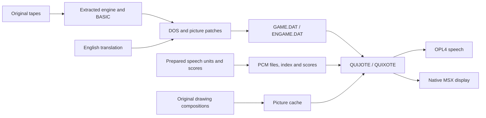
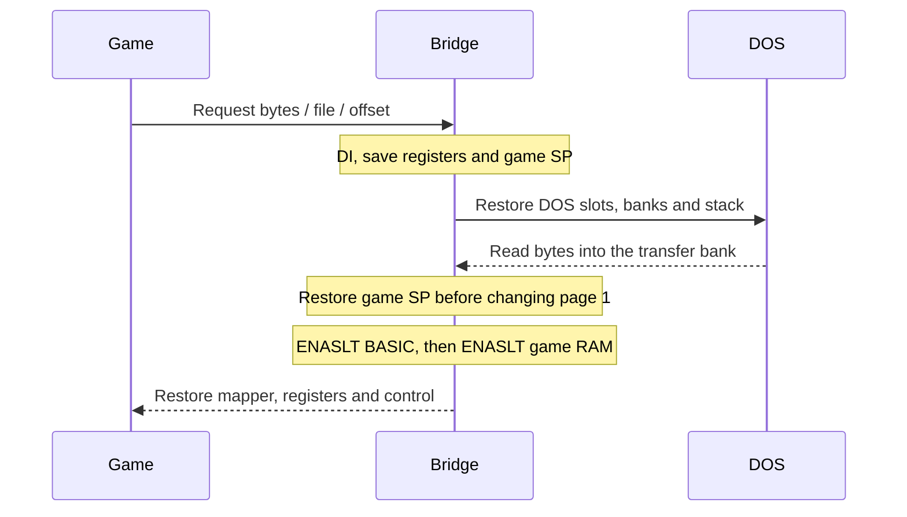
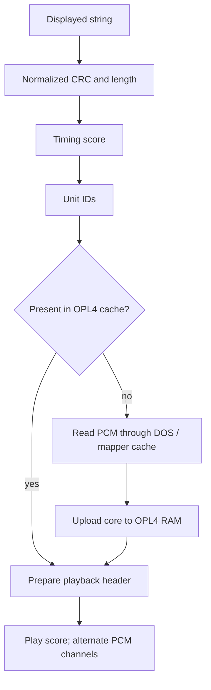

# MSX-DOS runtime design

## Overview

The original adventure combines tokenized BASIC with Z80 routines. This edition
retains their addresses and game logic. A small resident bridge above the
original CLEAR limits provides speech, picture loading and the transition
between the two parts. The DOS program and the game have separate mapper
contexts; disk operations briefly return to the DOS context.

## Startup requirements report

Before opening game resources, the loader probes up to 32 mapper segments of 16 KiB and 32 OPL4 pages of 64 KiB. It writes different tags to all addresses before reading them, so mirrored banks cannot appear as additional independent memory. Both Z80 probe bytes per segment are saved before writes and restored before returning to BIOS or DOS. This measures whether the required capacity is addressable; it is not an exhaustive cell test or a measurement of mapper capacity above 512 KiB.

The report shows compatible mapper capacity, OPL4 sample RAM and RAM reserved for the game. OPL4 status polling is bounded so an absent or unresponsive interface cannot leave startup waiting indefinitely. If requirements are met, RETURN continues to the introduction. Otherwise the report explains the missing requirement and returns to DOS. Narration hardware is required for this edition.

DOS2 reserves at least sixteen segments (256 KiB), plus an optional read cache. The game segments must belong to a single compatible mapper; they need not be consecutive. Separate 256 KiB mappers are not combined. DOS itself may use another mapper or internal RAM.

The loader still searches the expanded-primary/secondary-2 arrangement described below. If none is found, it explicitly says that RAM may exist in another slot or interface. This distinction is useful when interpreting configurations involving FlashJacks or MSXVR: the report does not add a driver or change the supported mapper arrangement. File-open/read errors are separate from memory errors and name the requested data file.

## Storage and memory

The runtime uses the FCB operations shared by DOS1 and DOS2. DOS1 reads the
current drive root. DOS2/Nextor resolves files in the current directory. The
executables differ in language, filenames and text lookup data, not in which
DOS version they support.

The loader locates a MegaFlashROM-style expanded RAM slot at secondary slot 2.
An equivalent interface must provide the disk API and the mapper arrangement
expected by that code. A generic claim of support for every SD interface would
be inaccurate; adapting another mapper arrangement involves the discovery
routine in `src/loader.asm`.

| Logical mapper segments | Use | Bytes |
|---|---|---:|
| 4–7 | Original game's four pages | 65,536 |
| 8–14 | Original-derived game loading images | 114,688 |
| 15 | Shared trampoline and transfer workspace | 16,384 |
| 16 | Speech lookup and unit index | 16,384 |
| 17–18 | Timing scores | 32,768 |
| 19 | Picture index | 16,384 |
| 20–31 | Disk read cache, when available | Up to 196,608 |

The sixteen mandatory segments use 256 KiB. DOS and its workspace also need
memory. The distribution requires a 512 KiB mapper. DOS1 selects banks outside
its own detected segments and requires the twelve cache segments. DOS2 obtains
segments through ALL_SEG and can use a smaller cache if fewer remain.
Logical numbers are translated by the BANK_MAP table at F100h.

Resident code begins at E000h. The score workspace begins at F000h and must
stay below 256 bytes. The initial password buffer occupies F200h–F23Fh before
the original game starts. The initial stack is F380h; the original CLEAR later
moves it below its game-specific limit.

## A disk read and its return

The shared trampoline lives in a bank visible in both contexts. It restores
DOS's original slots, banks and stack before invoking BDOS. In DOS2, PUT_P1
also updates the operating system's page-1 shadow around I/O; writing a mapper
port alone would leave software and hardware disagreeing.

The original USR return writes only the primary slot register A8h. On a turbo R,
DOS can leave MSX-MUSIC in the secondary selection for page 1 of primary slot 0.
That selection is hidden while the MFR RAM is visible. `io_return` therefore
selects `bios_slot` through ENASLT, selects the RAM again, and restores the
caller's mapper bank. This prepares the BASIC subslot before the original USR
makes it visible. The game stack is restored **before** either ENASLT call.

The game copy of the BIOS workspace has DOS hooks removed. MEMSIZ and STKTOP
are initialized before BASIC RUN so that its inherited stack cannot overwrite
the resident player. Closed BASIC file entries are recreated for RUN's close-all
pass. The DOS workspace remains separate.

## Picture loading

A room description first requests its complete picture. Only then is the text
printed and narrated. A picture contains two 4 KiB regions:

| File offset | VRAM destination | Contents |
|---|---|---|
| 0000h–0FFFh | 0000h–0FFFh | Picture pattern bytes |
| 1000h–1FFFh | 2000h–2FFFh | Picture colour bytes |

Fonts, the name table, text and sprites are outside those regions. Loading 8 KiB
contiguously into VRAM would overwrite them. The native VDP transfer uses the
necessary timing intervals.

VRAM.IDX has two 256-entry little-endian DWORD tables, first part A, then B.
Each entry is an offset in VRAM.DAT; FFFFFFFFh means no defined composition.
The generator follows BASIC RESTORE semantics, including gaps between DATA
lines, and deduplicates complete images. The 34 compositions produce 33 unique
blocks. The original darkness branches remain in BASIC. Clear-picture calls
outside room entry still clear the picture; they are not replaced by a room load.

## Speech lookup and playback

Text reaches the resident player through the original string output routines.
The player normalizes the text for lookup, calculating a CRC-CCITT and normalized
length. A matching entry points to a timing score. The visible text is not
rewritten to add pronunciation accents; the voice bank carries pronunciation.

A score event occupies six bytes:

| Bytes | Field |
|---|---|
| 0–1 | Delta ticks, little-endian |
| 2–3 | Unit ID; FFFFh ends the score |
| 4 | Padding parameter |
| 5 | Reserved |

The player prepares the referenced units in OPL4 sample RAM and then plays the
score. Consecutive events alternate between two PCM channels. A unit is stored
once in the bank and reused; event headers can point at the same sample with
different timing padding. This is a bank for the game's vocabulary, not a
universal speech engine.

| Language | Shared units | Lookup keys | PCM bytes with margins |
|---|---:|---:|---:|
| Spanish | 1,644 | 350 | 6,151,573 |
| English | 1,341 | 341 | 4,553,236 |

The included source banks use gzip for transport. Runtime files are signed
8-bit PCM at 8 kHz, split at 1 MiB and padded to 16 KiB boundaries. There is no
runtime decompression. Eight zero bytes border each sample core. The OPL4 cache
stores cores in its 2 MiB wave RAM, with generation-tagged entries near the top;
new scores reuse cached samples until the pool needs recycling.

## OPL4 timer and keyboard

The speech timer starts with FM register 04h = 01h: FT1 must remain unmasked
because the player polls that flag. Using 41h masks the same flag being awaited.
CPU interrupts remain disabled during this ownership period. Before EI, the
player stops/masks the timers with 60h and clears their flags with 80h.
A bounded wait disables narration with status E5 if the timer does not advance,
so control can return to the game. ESC is sampled directly from the keyboard
matrix to skip the current phrase.

The DiHalt introduction uses VBlank for its event stream and has its own OPL4
sample preparation. Its mixer is attenuated by 3 dB. Narration restores its
own configuration afterwards.

## Language and part selection

QUIJOTE.COM uses Spanish resource names; QUIXOTE.COM uses English names. Both
share BRAND.DAT, VRAM.DAT and VRAM.IDX. English localization repacks text,
objects and vocabulary within the original reserved areas. Exact English
aliases prevent ambiguities such as FIGHT/LIGHT. The BASIC bootstrap tail and
fixed early-line addresses remain intact.

After the introduction, empty RETURN starts part A. Either language's classic
password starts B from the loading picture. Spaces and letter case are ignored;
Backspace edits the input. Finishing A reaches B through the original ending
condition. Cassette save/load remains unchanged; there is no general resume-code
system or SD save-file facility.
