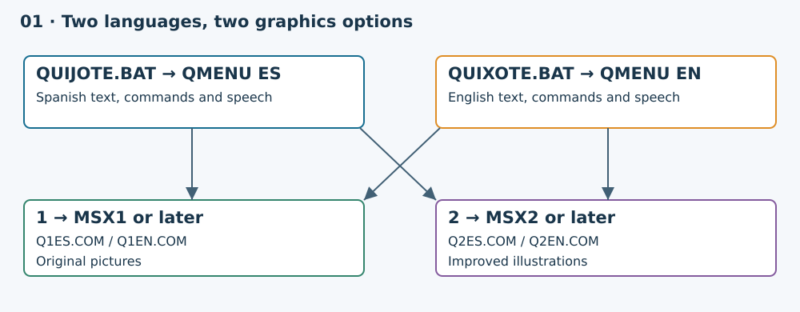
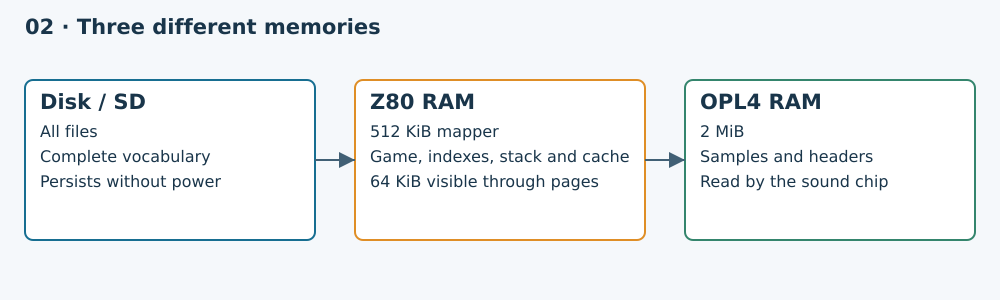
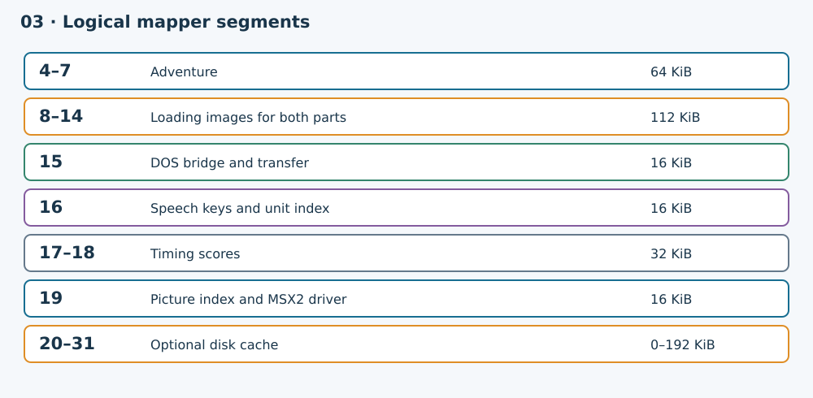
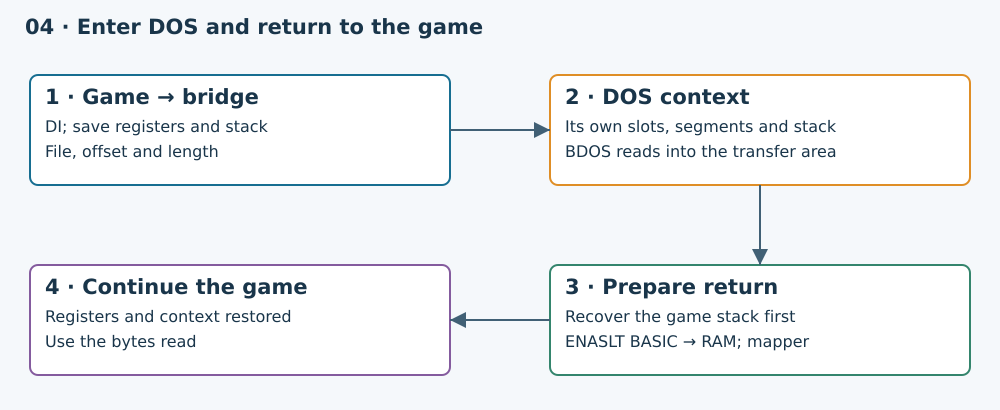
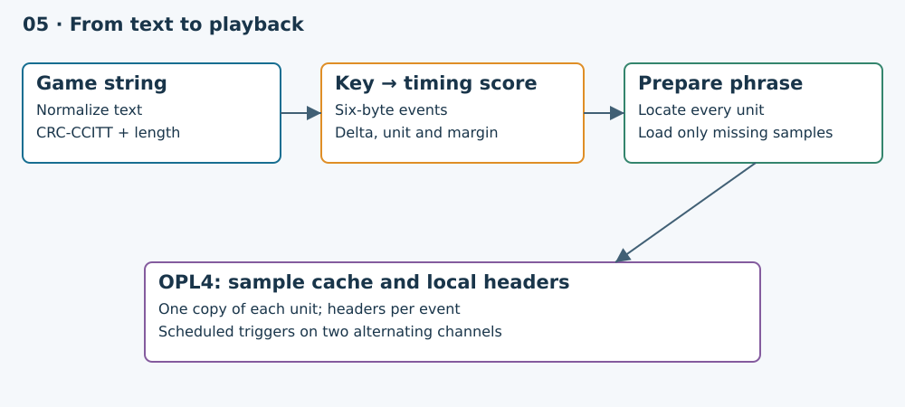
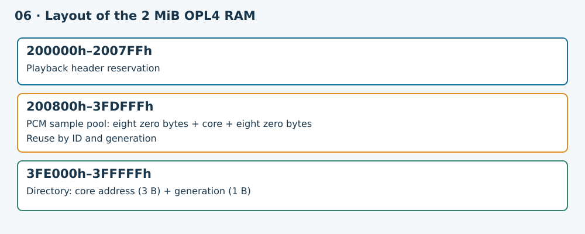
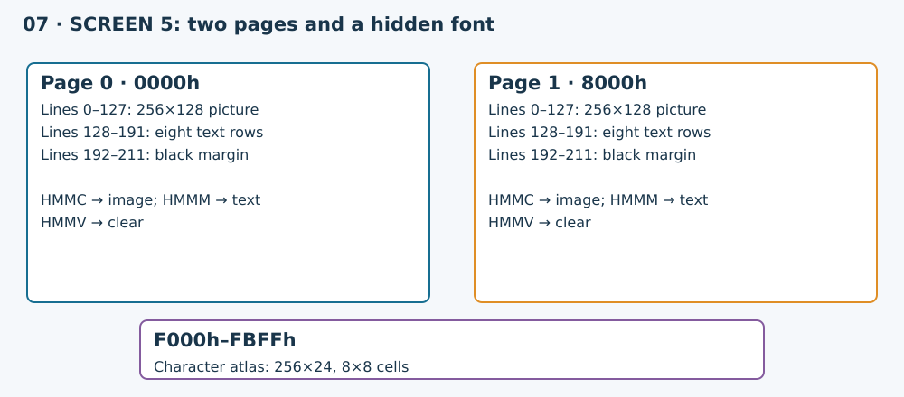
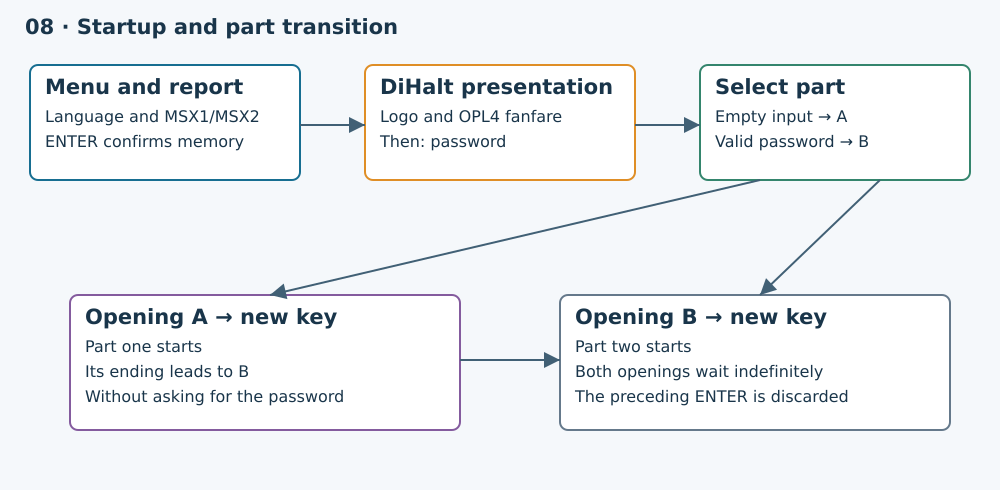

# Don Quijote / Don Quixote: technical reference

**Version 2.0 · MSX-DOS edition · MSX1 and MSX2 · Spanish and English · OPL4**

This reference describes the programs and files in the public distribution: language and video selection, loading both parts, memory, pictures and speech playback. The player manuals cover installation and commands; this document explains how the same package works. Public source and build instructions are available from the [DiHalt Studio repository](https://github.com/DiHaltStudio/donquijote-msx1-opl4-en-es).

[TOC]

## 1. One distribution and four programs

The `SD/` folder contains both graphics options in both languages. Keep all its files together. `QUIJOTE.BAT` runs `QMENU ES`; `QUIXOTE.BAT` runs `QMENU EN`. The selector reads a line containing 1, 2 or 0: MSX1, MSX2 or exit. The MSX1 option also runs on later machines; the MSX2 option requires that video generation or later.

| Language | MSX1 option | MSX2 option | Adventure data |
|---|---|---|---|
| Spanish | Q1ES.COM | Q2ES.COM | GAME.DAT / Q2ES.DAT |
| English | Q1EN.COM | Q2EN.COM | ENGAME.DAT / Q2EN.DAT |

Each program includes both parts. Choosing MSX1 or MSX2 changes the graphics presentation, not the structure of the adventure or its narration. The programs retain file operations compatible with DOS1 and DOS2/Nextor; a separate executable is not needed for each operating system.

The selector opens the chosen COM through an FCB, reads it into temporary storage from 8000h, and closes the file. A small trampoline at C000h then copies those bytes to 0100h and transfers control. This prevents the selector from overwriting itself while it is still executing its read. The command tail is emptied and the DMA address restored to 0080h before the loader starts. The selected COM must be smaller than 16 KiB.

The BAT files do not use `CHOICE` or `ERRORLEVEL`: selection and transfer are handled by `QMENU.COM`. When upgrading, remove old `QUIJOTE.COM` and `QUIXOTE.COM` files. The command interpreter finds a COM before a BAT with the same name.

## 2. Shared files and storage budget

There are not four copies of the speech. Both Spanish programs share one bank and both English programs another. `BRAND.DAT` serves all four. Each graphics bank is shared between languages, but the MSX1 and MSX2 pictures have different formats and retain their own files.

| File | Bytes | Purpose |
|---|---|---|
| `BRAND.DAT` | 49,152 | Presentation and fanfare |
| `ENGAME.DAT` | 114,688 | Adventure data |
| `ENINDEX.DAT` | 16,384 | Keys and unit index |
| `ENSCORE.DAT` | 32,768 | Timing scores |
| `ENVOX0.PCM` | 1,048,576 | Shared speech PCM |
| `ENVOX1.PCM` | 1,048,576 | Shared speech PCM |
| `ENVOX2.PCM` | 1,048,576 | Shared speech PCM |
| `ENVOX3.PCM` | 1,048,576 | Shared speech PCM |
| `ENVOX4.PCM` | 360,448 | Shared speech PCM |
| `GAME.DAT` | 114,688 | Adventure data |
| `INDEX.DAT` | 16,384 | Keys and unit index |
| `Q1EN.COM` | 7,006 | Game program |
| `Q1ES.COM` | 7,025 | Game program |
| `Q2EN.COM` | 7,216 | Game program |
| `Q2EN.DAT` | 114,688 | Adventure data |
| `Q2ES.COM` | 7,231 | Game program |
| `Q2ES.DAT` | 114,688 | Adventure data |
| `QMENU.COM` | 900 | Version selector |
| `QUIJOTE.BAT` | 32 | Language launcher |
| `QUIXOTE.BAT` | 32 | Language launcher |
| `SC5.DAT` | 594,016 | MSX2 pictures and font |
| `SC5.IDX` | 16,384 | MSX2 index and driver |
| `SCORES.DAT` | 32,768 | Timing scores |
| `VOICE0.PCM` | 1,048,576 | Shared speech PCM |
| `VOICE1.PCM` | 1,048,576 | Shared speech PCM |
| `VOICE2.PCM` | 1,048,576 | Shared speech PCM |
| `VOICE3.PCM` | 1,048,576 | Shared speech PCM |
| `VOICE4.PCM` | 1,048,576 | Shared speech PCM |
| `VOICE5.PCM` | 917,504 | Shared speech PCM |
| `VRAM.DAT` | 270,336 | MSX1 pictures |
| `VRAM.IDX` | 16,384 | MSX1 picture index |

The 31 game files total **12,247,906 bytes**, approximately **11.68 MiB**, excluding directory space and filesystem allocation rounding. KiB means 1,024 bytes and MiB 1,048,576 bytes. The PDF and HTML files in `DOCS/` are read on another computer and do not participate in game execution.

Indexes and some other files are padded to 16 KiB boundaries. Their file sizes include this padding; the useful PCM figures in the speech table do not. These numbers answer different questions: disk capacity versus sound content.

The manifest identifies files by name, length and SHA-256. Replacing a waveform without updating its index can cause a different sound to be read at that offset. Changing text without a matching key and score can leave that phrase without narration. The distribution unit is the coherent set, not an isolated COM.

## 3. Three memories with different purposes

The disk or SD stores programs, pictures and the complete vocabulary. Z80 RAM holds the adventure, variables, stacks, indexes and read cache. OPL4 RAM contains the samples and headers played by the chip. Having 2 MiB in the OPL4 does not extend executable Z80 RAM, and enlarging the mapper does not increase OPL4 wave capacity.

The Z80 sees a 64 KiB address space in four 16 KiB pages. A 512 KiB mapper provides 32 segments that can appear in those windows. Slots also determine which device responds in each page. Identifying a byte requires its address, slot and segment; reading a mapper port alone does not prove that independent RAM exists behind it.

The shared requirements are a compatible 512 KiB mapper and 2 MiB of OPL4 RAM. The game's banks belong to one mapper; two 256 KiB mappers are not combined. Physical segment numbers need not be consecutive. DOS itself may occupy internal RAM or a different mapper.

## 4. Initial report and RAM allocation

The loader determines the DOS version and locates the RAM arrangement it uses. Discovery covers an expanded primary slot with RAM in secondary slot 2, as in the MegaFlashROM SCC+ SD configuration. An equivalent interface needs to provide both the disk operations and the mapper arrangement expected by the loader; the presence of an SD card alone does not determine compatibility.

Before opening adventure resources, the loader probes the first 32 mapper segments and the wave RAM pages. It saves the bytes used, writes different tags, reads them all, and restores the data. Writing every tag before reading any makes mirrored banks distinguishable from additional independent memory.

The OPL4 probe distinguishes 64 KiB pages within its 2 MiB RAM. BUSY polling has a limit so that a missing or unresponsive interface can be reported. The report presents compatible capacity and available allocation. ENTER continues; an unmet requirement returns control to DOS with an explanation. This is an addressing probe, not an exhaustive examination of every memory cell.

DOS1 keeps the game away from the system's own banks and allocates the complete cache. DOS2/Nextor obtains segments through its manager, with a minimum of sixteen for the mandatory context and up to twelve more for caching. The cache can therefore be smaller when DOS occupies more RAM, even though the physical requirement remains a 512 KiB mapper.

## 5. Segments and workspace

| Logical segments | Purpose | Capacity |
|---|---|---:|
| 4–7 | Four adventure pages | 65,536 B |
| 8–14 | Loading images for both parts | 114,688 B |
| 15 | DOS/game trampoline and transfer workspace | 16,384 B |
| 16 | Speech keys and unit index | 16,384 B |
| 17–18 | Timing scores | 32,768 B |
| 19 | Picture index and MSX2 driver when applicable | 16,384 B |
| 20–31 | Read cache, subject to availability | Up to 196,608 B |

These are logical numbers. A table at F100h translates them into allocated physical segments. Resident code starts at E000h and the score workspace uses F000h with fewer than 256 bytes. During part selection, the editor has F200h–F23Fh. The initial stack is at F380h; BASIC later relocates it through CLEAR.

The MSX2 graphics driver occupies an area from C000h, reserved by lowering BASIC's limit. Large loading images may temporarily use that space during startup; the driver is installed again before each BASIC program executes. Its prepared copy shares the picture-index segment and does not require another mandatory segment.

BASIC file blocks need attention during a part change: loading images can overwrite the previous program's buffers, and RUN closes files before executing the new CLEAR. Closed descriptors are recreated in a suitable area and MEMSIZ and STKTOP are initialized again. Storage that appears free to the adventure must not be confused with a stack or descriptor still in use by BASIC.

## 6. A disk read and its return

The game supplies a file, offset and length. The bridge disables interrupts, saves registers and stack, and enters the shared segment. It restores DOS's slots, segments and stack, then calls BDOS. Reads arrive in a transfer area and are subsequently used as PCM, cached data or video data.

On return, the game stack is recovered first. Replacing the page-1 bank before leaving a stack there could make a CALL write its return address into another memory. Slot selections and the caller's mapper are then restored. DOS2's page-1 shadow is also synchronized through its API; a port OUT does not update that operating-system information.

Two levels of selection must be preserved. The original game's USR return changes primary slot register A8h and assumes BASIC remains selected in the corresponding secondary slot. A DOS operation can change a subslot hidden while RAM is visible. The bridge selects BIOS/BASIC through ENASLT first and then selects game RAM: when the USR exposes that primary slot, its secondary selection is ready.

The shared FCB operations explain how the same COM supports both DOS versions. DOS1 searches the current drive root. DOS2/Nextor can use the current directory. Running a program through a full path is not equivalent to entering its folder; data files are resolved from the working directory.

## 7. What a speech unit contains

The voices are distributed ready to use. Each bank contains long speech blocks with transitions and intonation, not one phoneme per letter or a universal voice capable of pronouncing arbitrary text. A phrase uses a sequence of block identifiers. The same identifier can appear in many phrases without duplicating its samples.

The runtime format is mono signed 8-bit PCM at 8,000 Hz: one second takes approximately 8,000 bytes. Sample identity, position and sample count are independent of the score bytes that schedule them.

| Language | Prepared messages | Unique keys | Units | PCM with margins |
|---|---|---|---|---|
| Spanish | 376 | 350 | 1,644 | 6,151,573 B |
| English | 376 | 341 | 1,341 | 4,553,236 B |

Silence uses ID 0. Excluding that silence, the average audible core lasts **0.466011 seconds** in Spanish and **0.422739 seconds** in English. Phrase duration cannot be obtained by multiplying a unit count by an average: the selected fragments, trigger times and margins all matter.

Each unit stores eight zero bytes before and eight after its core. A 4,990-sample unit occupies 5,006 bytes in the bank. Headers can start a few bytes before the core and adjust silence duration without storing another waveform. These are small playback variations over one copy of the sound.

In the public repository, `assets/speech/es/` and `assets/speech/en/` contain `catalog.json` and `units.pcm.gz`. Gzip reduces source transport size; the build expands this PCM into the game files. **There is no speech decompression during play.** Prepared assets make a build possible without installing a voice model or connecting a synthesis service.

## 8. Text keys and the unit index

The engine's output passes a string to the resident player. It computes a key from normalized text: CRC-CCITT and normalized length. The key finds a score; it is not audio and does not contain one character per sample. Several catalogue entries can share a key.

A lookup entry occupies seven bytes: a 16-bit CRC, a 16-bit length, a one-byte logical bank and a 16-bit score address. The unit index adds eight bytes per unit: a 32-bit PCM offset, a 16-bit core sample count and a reserved 16-bit field. These multibyte fields use little-endian order.

For Spanish, 350 seven-byte lookup entries and 1,644 eight-byte unit entries total 15,602 useful index bytes. For English, 341 and 1,341 entries total 13,115 bytes. Each index is padded to its 16,384-byte segment.

Voice files are split at 1 MiB. For global offset `p`, the file number is `p // 1048576` and its internal position is `p % 1048576`. This keeps unit identity independent of the bank's division into files. The Spanish and English tables have the same format, but their keys, units and offsets are not interchangeable.

Pronunciation corrections belong to the prepared samples. The adventure can display a Roman numeral or an unaccented word while playing its corresponding spoken reading. Replacing only a visible string does not automatically create narration for its translation: text, key, score and bank must remain matched.

## 9. Scores: six-byte events

| Offset within event | Field | Size |
|---|---|---:|
| 0 | Delta from the preceding event | 2 B |
| 2 | Unit ID; FFFFh terminates | 2 B |
| 4 | Margin adjustment | 1 B |
| 5 | Reserved | 1 B |

The score is copied to a workspace of fewer than 256 bytes. Deltas are relative: an event's time is found by summing previous values. A unit can be triggered before another has ended; two alternating PCM channels preserve these transitions. A list of words played strictly one after another does not describe this schedule.

This example shows the first events of a description from the Spanish catalogue. Times are the accumulated deltas multiplied by the timer period; the first unit is silence.

| Six bytes | Δ ticks | Unit | Margin | Accumulated | Seconds |
|---|---|---|---|---|---|
| `00 00 00 00 00 00` | 0 | 0 | 0 | 0 | 0.000000 |
| `e6 00 01 00 07 00` | 230 | 1 | 7 | 230 | 0.222959 |
| `84 02 02 00 02 00` | 644 | 2 | 2 | 874 | 0.847245 |
| `6f 02 03 00 01 00` | 623 | 3 | 1 | 1497 | 1.451173 |
| `6e 02 04 00 07 00` | 622 | 4 | 7 | 2119 | 2.054133 |
| `cc 00 05 00 04 00` | 204 | 5 | 4 | 2323 | 2.251888 |

The nominal period is `72 × 38 × 12 / 33868800`, approximately 0.000969388 seconds. A delta of 230 represents about 0.223 seconds. The final event stops execution rather than identifying another sample. The margin parameter changes the temporary header for that occurrence, not the original shared PCM.

## 10. Caching in OPL4 RAM

Wave RAM is addressed in OPL4 range 200000h–3FFFFFh. Its beginning reserves space for headers; the sample pool starts at 200800h. The first unit's core begins eight bytes after its allocation starts. The cache directory starts at 3FE000h, within the last 8 KiB.

Each directory entry occupies four bytes: a three-byte core address and a one-byte generation. Matching an ID and generation permits existing samples to be reused. Recycling the pool changes the generation; addresses from an older generation become invalid even though their bytes have not been erased. The directory is cleared when the counter wraps.

The complete phrase is prepared before the first key-on. Its units are located, missing ones are loaded, and twelve-byte local headers are constructed for each occurrence. The player recycles the pool before preparing a phrase when its threshold requires it; the builder limits a phrase's total load to prevent units from being evicted halfway through preparation.

This cache does not make the whole bank permanently resident. Spanish PCM exceeds six million bytes and English PCM four million; the chip has two MiB of RAM. A repeated fragment can avoid another read while still present. After recycling, it must be loaded again.

## 11. Mapper cache, latency and playback clock

The mapper cache keeps read blocks from voice files. It is a separate layer from the OPL4 cache: it can hold a unit's bytes even though they still need to be transferred to the chip. An OPL4 hit avoids both operations; a mapper-only hit avoids physical storage access but still requires the OPL4 transfer.

Preparation explains the delay that can occur between displaying a phrase and hearing it. It depends on how many blocks are new, their sizes, the storage medium and both caches' state. Reducing score bytes does not automatically reduce the missing PCM load. A long phrase is not loaded as one monolithic WAV: its units are collected and those already present are reused.

During playback, the OPL4 timer uses FM register 04h = 01h. FT1 remains unmasked because the program polls that same flag; the CPU keeps DI while owning the clock. Before EI, the timers are stopped and masked with 60h and their flags cleared with 80h. A bounded wait returns control if the timer does not advance.

ESC is read directly from the matrix during narration. It does not depend on a BIOS interrupt left disabled. On completion or cancellation, the used channels are switched off and the game context restored.

## 12. MSX1 pictures

The graphics index contains two tables of 256 32-bit offsets, one per part. FFFFFFFFh means there is no defined composition. Equal compositions share a block: 34 compositions correspond to 33 distinct blocks, including the shared black image.

A room image occupies 8 KiB of patterns and colours. The first 4 KiB go to VRAM 0000h–0FFFh and the second to 2000h–2FFFh. They must not be written as one contiguous 8 KiB area: data between those regions does not belong to the drawing. Font, text and other table regions are preserved.

The engine requests the drawing before printing and narrating the description. Darkness branches still decide whether a picture should be shown. An independent clear remains a clear; turning every clear into a room reload would change that behaviour.

## 13. MSX2 pictures and font

The MSX2 option represents rooms in SCREEN 5, at 256×128 pixels with two colour indexes per byte. Each drawing block occupies 16,384 bytes followed by 32 palette bytes. Index 0 is black and index 15 white; the other fourteen change with each image. Text therefore retains its colour when the landscape palette changes.

The screen uses 212 lines. The picture occupies the first 128; eight character rows occupy lines 128–191, with a black margin below. The two pages start at 0000h and 8000h. The original font atlas occupies F000h–FBFFh, 256×24 pixels, outside both visible areas. This layout fits the first 64 KiB of VRAM.

Each character is copied from an atlas cell using an 8×8 HMMM. Scrolling uses a 256×56 copy and a 256×8 HMMV clears the last row. The CPU programs coordinates and dimensions rather than tracing each character's pixels again. Word wrapping and uppercase handling retain the adventure's behaviour.

The next picture is prepared on the hidden page using HMMC. DOS supplies packed bytes and the CPU transfers them to the VDP data register when TR permits it. The command engine generates destination addresses. HMMM preserves the text, and page and palette are switched during VBlank; only then do the description and speech begin.

HMMC consumes its first byte from CLR when it starts. The driver prepares coordinates, supplies the first real byte and activates the command; the rest follows while waiting for TR. Starting with an empty CLR and then transmitting every byte would shift the image. If reading fails, the transfer is aborted so that the program does not await a command needing data that will never arrive.

`SC5.DAT` contains the 3,072-byte atlas, opening and logo at 24,576+32 bytes each, and 33 images at 16,384+32 bytes each: 594,016 bytes altogether. `SC5.IDX` occupies 16 KiB; its first two tables index rooms and the remaining space holds the driver's copy. The recoloured opening preserves the original drawing's silhouettes and pixel pattern.

## 14. Introduction, password and linked parts

After the menu, the memory report waits for ENTER. The DiHalt presentation and an approximately ten-second fanfare follow. That presentation uses a 500-frame event schedule at a logical 50 Hz, adapted to video frequency. Narration restores its own OPL4 configuration afterwards.

The password is requested before loading a part. Empty input and ENTER select the first; the classic password selects the second. Spanish and English variants are accepted, ignoring case and spaces; Backspace permits editing. An incorrect password returns to the editor.

The opening remains indefinitely until a new key. Previous keys must first be released and the BIOS buffer emptied; CHGET then waits with interrupts enabled. This prevents the preceding ENTER from skipping the picture. Return clears the queue and restores DI before continuing the bootstrap.

Completing part one retains its message and loads part two without requesting the password again. Part two's opening also waits for a key. This joins the two adventures, rather than implementing intermediate saved positions: save and load commands retain their cassette function.

The editor limits each command to 31 characters, including spaces; the remaining cell of the 32-column row holds the cursor. The shared routine in `common/command_input.asm` compares the write pointer (738Ch) against the buffer base (738Eh) before returning a printable character to the engine. Once the difference reaches 31, further letters and spaces are discarded; Backspace and ENTER remain available. The limit therefore does not depend on the visible column being preserved. Control characters other than deletion and submission are ignored.

The MSX2 renderer also honours the column limit maintained by the engine at 7060h: normally 32, temporarily 33 when drawing the cursor. This lets the cursor occupy the last cell without scrolling the text or resetting the editor column. The buffer check applies to both languages and both graphics options.

## 15. Public documents and resources

The repository contains the design in `docs/DESIGN.md`, build requirements and commands in `docs/BUILDING.md`, loader and player sources in `src/`, and prepared assets in `assets/`. Speech catalogues and their compressed PCM match by language; the English translation is in `assets/english/translation.json`. English voice attribution is provided in `VOICE-NOTICE.txt`.

This reference has two equivalent source texts and produces `TECNICA-es.pdf/html` and `TECNICA-en.pdf/html`. Its figures and tables belong to the same documentation set. `MANUAL-ES.pdf` and `MANUAL-EN.pdf` are for players rather than engine instructions.

Changing a voice requires keeping the core offset, length, hash, lookup key and score matched. Changing a picture requires retaining its dimensions, format and room associations. A language change must cover visible text, parser vocabulary and narration; translating the interface alone does not change game rules or produce new audio.

Don Quijote was published by Dinamic in 1987. The MSX-DOS adaptation, OPL4 integration, graphics selection and documentation are DiHalt Studio's work. The original adventure, text and artwork retain their respective authorship and rights. This is an unofficial adaptation without affiliation with the original authors.
