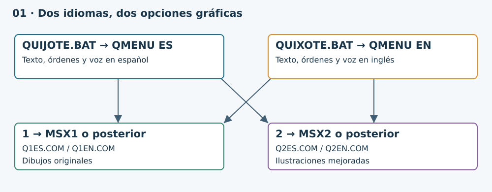
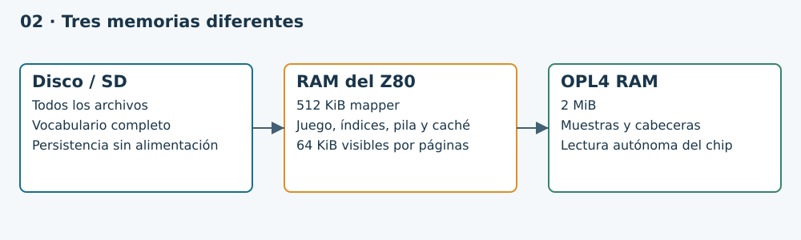
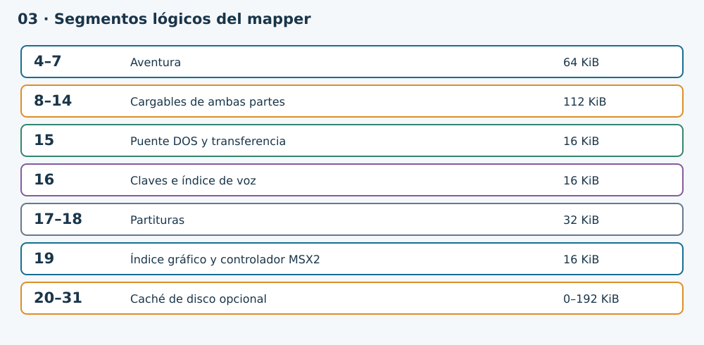
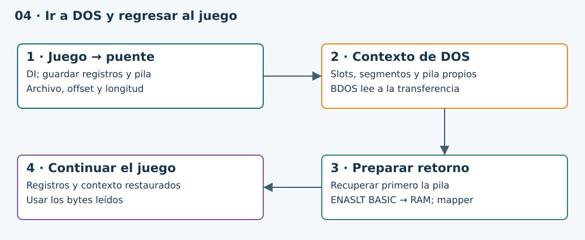
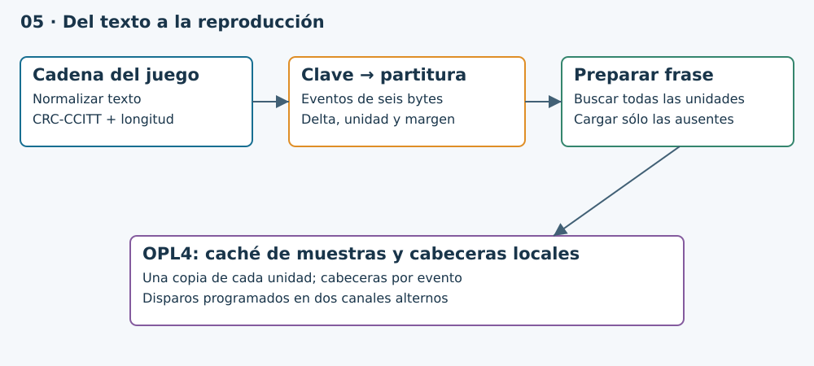
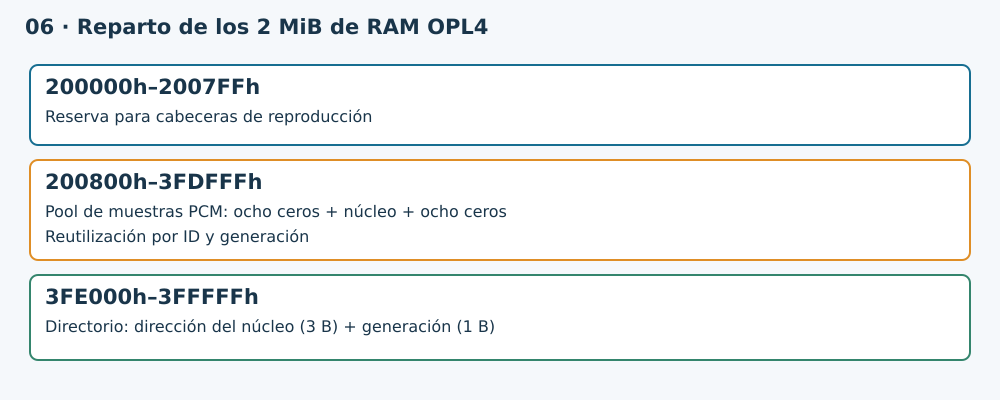
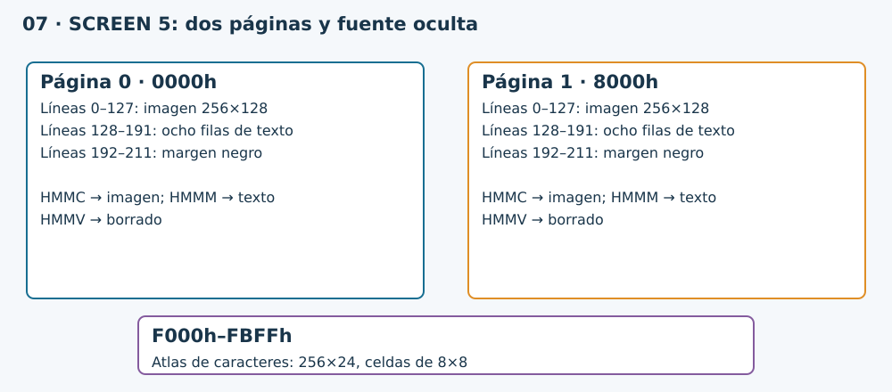
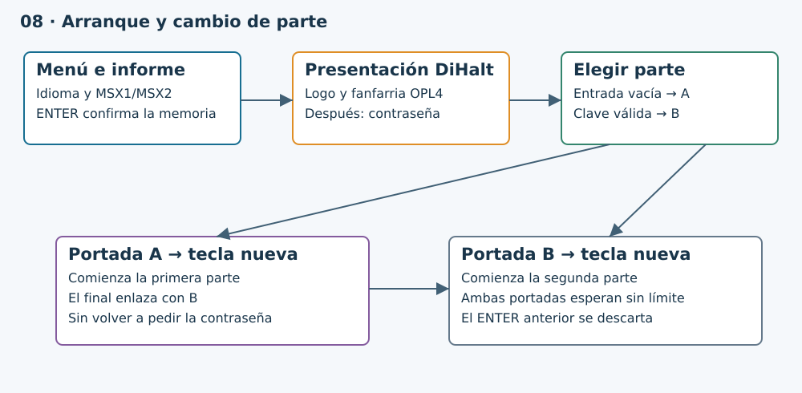

# Don Quijote / Don Quixote: referencia técnica

**Edición MSX-DOS · MSX1 y MSX2 · Español e inglés · OPL4**

Esta referencia describe el programa y los archivos de la distribución pública: selección de idioma y vídeo, carga de las dos partes, memoria, imágenes y reproducción de voz. Los manuales del jugador explican instalación y órdenes; aquí se desarrolla el funcionamiento del mismo paquete. El código público y sus instrucciones de construcción están en el [repositorio de DiHalt Studio](https://github.com/DiHaltStudio/donquijote-msx1-opl4-en-es).

[TOC]

## 1. Una distribución y cuatro programas

La carpeta `SD/` contiene las dos opciones gráficas en los dos idiomas. Todos sus archivos deben permanecer juntos. `QUIJOTE.BAT` ejecuta `QMENU ES`; `QUIXOTE.BAT` ejecuta `QMENU EN`. El selector recibe una línea con 1, 2 o 0: MSX1, MSX2 o salida. La opción MSX1 funciona también en equipos posteriores; la opción MSX2 exige esa generación de vídeo o una posterior.

| Idioma | Opción MSX1 | Opción MSX2 | Datos de aventura |
|---|---|---|---|
| Español | Q1ES.COM | Q2ES.COM | GAME.DAT / Q2ES.DAT |
| Inglés | Q1EN.COM | Q2EN.COM | ENGAME.DAT / Q2EN.DAT |

Cada programa incorpora las dos partes. Elegir MSX1 o MSX2 cambia la representación gráfica, no la estructura de la aventura ni su narración. Los programas conservan llamadas de archivo compatibles con DOS1 y DOS2/Nextor; no hace falta otro ejecutable por sistema operativo.

El selector abre el COM elegido con FCB, lo lee a una zona temporal desde 8000h y cierra el archivo. Un pequeño trampolín en C000h copia después esos bytes a 0100h y transfiere el control. Así el selector no se sobrescribe mientras todavía ejecuta su lectura. La cola de órdenes queda vacía y la dirección DMA vuelve a 0080h antes de comenzar el cargador. El límite del COM seleccionado es inferior a 16 KiB.

Los BAT no utilizan `CHOICE` ni `ERRORLEVEL`: la selección y la transferencia pertenecen a `QMENU.COM`. Al actualizar una instalación deben quitarse los antiguos `QUIJOTE.COM` y `QUIXOTE.COM`; la búsqueda del intérprete encuentra un COM antes que el BAT del mismo nombre.

## 2. Archivos comunes y presupuesto de almacenamiento

No hay cuatro copias de las voces. Los dos programas españoles comparten un banco y los dos ingleses otro. `BRAND.DAT` sirve a los cuatro. Cada banco gráfico se comparte entre idiomas, pero los dibujos MSX1 y MSX2 tienen formatos diferentes y conservan sus propios archivos.

@@FILES@@

La suma de los 31 archivos de juego es **@@SD_BYTES@@ bytes**, aproximadamente **@@SD_MIB@@ MiB**, sin contar el espacio de directorio y el redondeo de asignación del sistema de archivos. KiB significa 1.024 bytes y MiB 1.048.576 bytes. Los PDF y HTML de `DOCS/` se consultan en otro ordenador y no intervienen en la ejecución.

Los índices y algunos archivos se rellenan hasta límites de 16 KiB. El tamaño del archivo incluye ese relleno; la cantidad de PCM útil de la tabla de voz lo excluye. Ambas cifras responden a preguntas distintas: espacio de disco frente a contenido sonoro.

El manifiesto identifica cada archivo por nombre, bytes y SHA-256. Cambiar una onda sin actualizar su índice puede hacer que otro sonido se lea en ese offset. Cambiar el texto sin una clave y partitura correspondientes puede dejar esa frase sin narración. La unidad de distribución es el conjunto coherente, no un COM aislado.

## 3. Tres memorias que cumplen funciones diferentes

El disco o la SD conserva los programas, las imágenes y el vocabulario completo. La RAM del Z80 aloja la aventura, sus variables, pilas, índices y caché de lecturas. La RAM del OPL4 contiene las muestras y cabeceras que el chip reproduce. Tener 2 MiB en OPL4 no amplía la RAM ejecutable del Z80, y ampliar el mapper no aumenta la capacidad de ondas del OPL4.

El Z80 ve 64 KiB de direcciones en cuatro páginas de 16 KiB. Un mapper de 512 KiB proporciona 32 segmentos que pueden aparecer en esas ventanas. Además, los slots deciden qué dispositivo responde en cada página. Para identificar un byte hacen falta dirección, slot y segmento; el número leído de un puerto mapper no demuestra por sí solo que exista RAM independiente detrás.

Los requisitos comunes son un mapper compatible de 512 KiB y 2 MiB de RAM OPL4. Los bancos del juego pertenecen a un mismo mapper; dos mappers de 256 KiB no se suman. Los segmentos físicos no necesitan ser consecutivos. El contexto de DOS sí puede ocupar RAM interna u otro mapper distinto.

## 4. Informe inicial y reserva de RAM

El cargador determina la versión de DOS y localiza la disposición de RAM que utiliza. La búsqueda contempla un primario expandido con RAM en secundario 2, como la configuración MegaFlashROM SCC+ SD. Una interfaz equivalente necesita ofrecer tanto las operaciones de disco como la disposición de mapper que espera el cargador; disponer de una SD por sí solo no determina la compatibilidad.

Antes de abrir los recursos de la aventura se sondean los primeros 32 segmentos del mapper y las páginas de RAM de ondas. Se conservan los bytes empleados, se escriben etiquetas diferentes, se leen todas y se restauran los datos. Escribir todas las etiquetas antes de leerlas permite reconocer bancos reflejados que responderían como si fueran memoria adicional.

El sondeo OPL4 distingue páginas de 64 KiB dentro de su RAM de 2 MiB. La espera del estado BUSY tiene límite para poder informar de una interfaz ausente o sin respuesta. El informe presenta la capacidad compatible y la reserva disponible. ENTER continúa; un requisito insuficiente devuelve el control a DOS con su explicación. Es un sondeo de direccionamiento, no una inspección exhaustiva de cada celda de memoria.

DOS1 mantiene al juego fuera de los bancos del propio sistema y reserva la caché completa. DOS2/Nextor obtiene segmentos mediante su gestor, con un mínimo de dieciséis para el contexto obligatorio y hasta doce más para caché. Por eso pueden quedar menos segmentos de caché cuando DOS ocupa más RAM, aunque el requisito físico siga siendo un mapper de 512 KiB.

## 5. Segmentos y espacio de trabajo

| Segmentos lógicos | Uso | Capacidad |
|---|---|---:|
| 4–7 | Cuatro páginas de la aventura | 65.536 B |
| 8–14 | Cargables de las dos partes | 114.688 B |
| 15 | Trampolín y transferencia DOS/juego | 16.384 B |
| 16 | Claves e índice de unidades de voz | 16.384 B |
| 17–18 | Partituras | 32.768 B |
| 19 | Índice gráfico y controlador MSX2 cuando corresponde | 16.384 B |
| 20–31 | Caché de lecturas, según disponibilidad | Hasta 196.608 B |

Los números son lógicos. Una tabla en F100h los convierte en los segmentos físicos asignados. El residente comienza en E000h y la partitura de trabajo utiliza F000h con menos de 256 bytes. Durante la selección de parte, el editor dispone de F200h–F23Fh. La pila inicial se sitúa en F380h; BASIC la recoloca después con su instrucción CLEAR.

El controlador gráfico MSX2 ocupa una zona desde C000h y el programa reserva ese espacio reduciendo el límite de BASIC. Los grandes cargables pueden utilizarlo transitoriamente durante el arranque; el controlador se reinstala antes de ejecutar cada programa BASIC. Su copia preparada comparte el segmento del índice gráfico y no exige otro segmento obligatorio.

Los bloques de archivo BASIC merecen atención al cambiar de parte: los cargables pueden sobrescribir los buffers del programa anterior y RUN cierra archivos antes de ejecutar el nuevo CLEAR. Se reconstruyen descriptores cerrados en una zona adecuada y se reinicializan MEMSIZ y STKTOP. Los datos que parecen libres para la aventura no deben confundirse con una pila o descriptor todavía en uso por BASIC.

## 6. Una lectura de disco y su retorno

El juego indica archivo, offset y longitud. El puente deshabilita interrupciones, guarda registros y pila, y entra en el segmento compartido. Desde allí repone los slots, segmentos y pila del DOS y llama a BDOS. Las lecturas llegan a una zona de transferencia; después se utilizan como PCM, datos de caché o datos de vídeo.

Al regresar se recupera primero la pila del juego. Cambiar el banco de página 1 antes de abandonarla podría hacer que un CALL escribiera su dirección de retorno en otra memoria. Después se restauran las selecciones y el mapper del llamador. En DOS2 se sincroniza también la sombra de página 1 mediante su API; un OUT al puerto no actualiza esa información del sistema.

Hay dos niveles de selección que preservar. El retorno USR del juego original modifica el registro primario A8h y presupone que BASIC sigue elegido en el secundario correspondiente. Una operación DOS puede cambiar un subslot que queda oculto mientras se ve la RAM. El puente selecciona primero BIOS/BASIC con ENASLT y después la RAM del juego: cuando el USR vuelva a exponer ese primario, su secundario estará preparado.

Las operaciones FCB compartidas explican el uso del mismo COM en los dos DOS. DOS1 busca en la raíz de la unidad actual. DOS2/Nextor puede utilizar el directorio actual. Ejecutar un programa mediante una ruta completa no equivale a entrar en su carpeta; los datos se resuelven desde el directorio de trabajo.

## 7. Qué contiene una unidad de voz

Las voces se distribuyen preparadas. Cada banco contiene bloques largos de habla con transiciones y entonación, no un fonema por letra ni una voz universal que pueda pronunciar texto arbitrario. Una frase utiliza una secuencia de identificadores de esos bloques. El mismo identificador puede aparecer en muchas frases sin duplicar sus muestras.

El formato de ejecución es PCM mono de 8 bits con signo a 8.000 Hz: un segundo requiere aproximadamente 8.000 bytes. La identidad de las muestras, su posición y su número de muestras son independientes de los bytes de la partitura que las programa.

@@VOICE@@

El silencio ocupa el identificador 0. La media de los núcleos audibles, excluido ese silencio, es **@@ES_MEAN@@ segundos** en español y **@@EN_MEAN@@ segundos** en inglés. La duración de una frase no se obtiene multiplicando el número de unidades por una media: intervienen los fragmentos elegidos, sus instantes de disparo y sus márgenes.

Cada unidad guarda ocho bytes cero antes y ocho después del núcleo. Una unidad de 4.990 muestras ocupa 5.006 bytes en el banco. Las cabeceras pueden comenzar algunos bytes antes del núcleo y ajustar su duración de silencio sin guardar otra onda. Son pequeñas variaciones de ejecución sobre una copia única del sonido.

En el repositorio público, `assets/speech/es/` y `assets/speech/en/` contienen `catalog.json` y `units.pcm.gz`. Gzip reduce su transporte como fuentes; la construcción expande ese PCM hacia los archivos del juego. **No hay descompresión de voz durante la partida.** Los recursos preparados permiten construir sin instalar un modelo de voz ni conectar un servicio de síntesis.

## 8. Claves de texto e índice de unidades

La salida del motor entrega una cadena al residente. Este calcula su clave a partir del texto normalizado: CRC-CCITT y longitud normalizada. La clave encuentra una partitura; no es el audio ni contiene una letra por muestra. Varias entradas de catálogo pueden compartir la misma clave.

Una entrada de búsqueda ocupa siete bytes: CRC de 16 bits, longitud de 16 bits, número lógico de banco de un byte y dirección de partitura de 16 bits. El índice de unidades añade ocho bytes por unidad: offset PCM de 32 bits, muestras del núcleo de 16 bits y un campo reservado de 16 bits. Se emplea orden little-endian para esos campos multibyte.

En español, 350 entradas de siete bytes y 1.644 entradas de ocho suman 15.602 bytes de índice útil. En inglés, 341 y 1.341 entradas suman 13.115 bytes. Cada índice se rellena hasta los 16.384 bytes de su segmento.

Los archivos de voz se separan a 1 MiB. Para un offset global `p`, el número de archivo es `p // 1048576` y su posición interna `p % 1048576`. Esta división evita que el identificador de unidad dependa de cómo se haya repartido el banco entre archivos. Las tablas de español e inglés tienen el mismo formato, pero sus claves, unidades y offsets no son intercambiables.

Las correcciones de pronunciación pertenecen a las muestras preparadas. La aventura puede mostrar un número romano o una palabra sin tilde y reproducir la lectura correspondiente. Reemplazar sólo una cadena visible no crea automáticamente la narración de su traducción: texto, clave, partitura y banco deben mantener su correspondencia.

## 9. Partituras: eventos de seis bytes

| Offset dentro del evento | Campo | Tamaño |
|---|---|---:|
| 0 | Delta desde el evento anterior | 2 B |
| 2 | ID de unidad; FFFFh termina | 2 B |
| 4 | Ajuste de margen | 1 B |
| 5 | Reservado | 1 B |

La partitura se copia a una zona de menos de 256 bytes. Los deltas son relativos: el instante de cada evento se obtiene sumando los anteriores. Una unidad se puede disparar antes de que haya terminado otra; dos canales PCM alternos conservan esas transiciones. Una lista de palabras reproducida una detrás de otra no describe este calendario.

Este ejemplo muestra los primeros eventos de una descripción del catálogo español. Los tiempos son la suma de deltas multiplicada por el periodo del temporizador; la primera unidad es silencio.

@@SCORE@@

El periodo nominal se obtiene con `72 × 38 × 12 / 33868800`, aproximadamente 0,000969388 segundos. Un delta de 230 representa unos 0,223 segundos. El evento final detiene la ejecución; no identifica otra muestra. El parámetro de margen modifica la cabecera temporal de esa aparición, no el PCM original compartido.

## 10. Caché en la RAM OPL4

La RAM de ondas se direcciona en el intervalo OPL4 200000h–3FFFFFh. Su comienzo reserva espacio para cabeceras; el pool de muestras parte de 200800h. El núcleo de la primera unidad comienza ocho bytes después de su inicio de asignación. El directorio de caché se encuentra desde 3FE000h, dentro de los últimos 8 KiB.

Cada entrada del directorio ocupa cuatro bytes: dirección del núcleo en tres bytes y generación en uno. Una coincidencia de ID y generación permite reutilizar las muestras existentes. Cuando se reinicia el pool cambia la generación; las direcciones de una generación anterior dejan de ser válidas aunque sus bytes no se hayan borrado. Al dar la vuelta al contador se limpia el directorio.

La frase se prepara completa antes del primer key-on. Se localizan sus unidades, se cargan las ausentes y se construyen cabeceras locales de doce bytes por aparición. El reproductor recicla el pool antes de preparar una frase cuando su umbral lo exige; el constructor limita la carga total de una frase para impedir que se expulsen unidades a mitad de esa preparación.

Esta caché no convierte el banco en residente permanente. El PCM español supera seis millones de bytes y el inglés cuatro millones; la RAM del chip tiene dos MiB. Un fragmento repetido puede evitar otra lectura si sigue presente. Tras reciclar el pool habrá que cargarlo de nuevo.

## 11. Caché mapper, latencia y reloj de reproducción

La caché mapper conserva bloques de lectura de los archivos de voz. Es una capa distinta de la caché OPL4: puede contener los bytes de una unidad que todavía deba transferirse al chip. Una unidad presente en OPL4 evita ambas operaciones; un acierto sólo en mapper evita la lectura física, pero mantiene la transferencia hacia OPL4.

La preparación explica la pausa que puede existir entre mostrar una frase y oírla. Depende de cuántos bloques sean nuevos, de sus tamaños, del medio de almacenamiento y del estado de las dos cachés. Reducir bytes de partitura no reduce automáticamente el PCM que falta cargar. La frase larga no se carga como un WAV monolítico: se reúnen sus unidades y se reutilizan las ya presentes.

Durante la reproducción, el temporizador OPL4 utiliza el registro FM 04h con 01h. FT1 permanece sin enmascarar porque el programa consulta ese mismo flag; la CPU mantiene DI mientras posee el reloj. Antes de EI se detienen y enmascaran los temporizadores con 60h y se limpian sus flags con 80h. Una espera acotada devuelve el control si el temporizador no avanza.

ESC se consulta directamente en la matriz durante la narración. No depende de una interrupción BIOS que se haya dejado deshabilitada. Al terminar o cancelar se apagan los canales utilizados y se restaura el contexto del juego.

## 12. Imágenes MSX1

El índice gráfico contiene dos tablas de 256 offsets de 32 bits, una por parte. FFFFFFFFh significa que no hay composición definida. Las composiciones iguales comparten un bloque: 34 composiciones corresponden a 33 bloques distintos, incluido el negro común.

Una imagen de habitación ocupa 8 KiB de patrones y colores. Los primeros 4 KiB van a VRAM 0000h–0FFFh; los segundos, a 2000h–2FFFh. No se deben volcar como 8 KiB contiguos: entre esas zonas existen datos que no pertenecen al dibujo. Las regiones de fuente, texto y tablas restantes se conservan.

El motor solicita el dibujo antes de imprimir y narrar la descripción. Las ramas de oscuridad siguen decidiendo si una imagen debe mostrarse. Un borrado independiente continúa siendo un borrado; convertir cada limpieza en una recarga de habitación alteraría ese comportamiento.

## 13. Imágenes y fuente MSX2

La opción MSX2 representa las habitaciones en SCREEN 5, con 256×128 píxeles y dos índices de color por byte. Cada bloque de dibujo ocupa 16.384 bytes y lo siguen 32 bytes de paleta. El índice 0 es negro y el 15 blanco; los otros catorce cambian por imagen. Así el texto conserva su color al cambiar la paleta del paisaje.

La pantalla utiliza 212 líneas. El dibujo ocupa las primeras 128; ocho filas de caracteres ocupan las líneas 128–191 y queda margen negro debajo. Las dos páginas se sitúan en 0000h y 8000h. El atlas de la fuente original ocupa F000h–FBFFh, 256×24 píxeles, fuera de ambas zonas visibles. El reparto cabe en los primeros 64 KiB de VRAM.

Cada carácter se copia desde una celda del atlas mediante HMMM de 8×8. El scroll es una copia de 256×56 y el borrado de la última fila un HMMV de 256×8. La CPU programa coordenadas y dimensiones; no vuelve a trazar los píxeles de cada letra. El ajuste de palabras y el tratamiento de mayúsculas conservan el comportamiento de la aventura.

La imagen siguiente se prepara en la página oculta con HMMC. DOS entrega bytes empaquetados y la CPU los transfiere al registro de datos del VDP cuando TR lo permite. El motor de comandos genera las direcciones de destino. Se conserva el texto con HMMM y se cambia de página y paleta durante VBlank; sólo después comienza la descripción y su voz.

HMMC consume su primer byte desde CLR al arrancar. El controlador prepara las coordenadas, coloca el primer byte real y activa el comando; el resto llega esperando TR. Arrancar con un CLR vacío y transmitir después todos los bytes desplazaría el dibujo. Si falla la lectura se aborta la transferencia, para no esperar un comando que necesita datos que no llegarán.

`SC5.DAT` contiene el atlas de 3.072 bytes, portada y logo de 24.576+32 bytes cada uno, y las 33 imágenes de 16.384+32 bytes: 594.016 bytes en total. `SC5.IDX` ocupa 16 KiB; sus primeras dos tablas indexan habitaciones y el espacio restante aloja la copia del controlador. La portada recoloreada mantiene las siluetas y la trama del dibujo original.

## 14. Apertura, contraseña y enlace de las partes

Tras el menú, el informe de memoria espera ENTER. Siguen la presentación DiHalt y su fanfarria de unos diez segundos. La reproducción de esa presentación utiliza un calendario de 500 cuadros a 50 Hz lógico, con adaptación a la frecuencia de vídeo. Al acabar, la narración recupera su propia configuración OPL4.

La contraseña se solicita antes de cargar la parte. Entrada vacía y ENTER seleccionan la primera; la clave clásica selecciona la segunda. Se aceptan las variantes española e inglesa, ignorando mayúsculas y espacios; Backspace permite corregir. Una clave incorrecta devuelve al editor.

La portada permanece indefinidamente hasta una tecla nueva. Primero se espera la liberación de teclas previas y se vacía el búfer BIOS; después CHGET espera con interrupciones habilitadas. Así el ENTER anterior no salta la imagen. El retorno limpia la cola y recupera DI antes de continuar el bootstrap.

Al terminar la primera parte se mantiene su aviso y se carga la segunda sin volver a pedir la contraseña. La portada de esa segunda parte también espera una tecla. Es un enlace entre las dos aventuras, no un sistema de posiciones intermedias: las órdenes de guardar y cargar conservan su función de cinta.

Cada orden admite 31 caracteres, incluidos los espacios, más el cursor en la fila de 32 columnas. En `common/command_input.asm`, la diferencia entre el puntero de escritura (738Ch) y la base (738Eh) limita la entrada independientemente de la columna visible. Al llegar a 31 se ignoran letras y espacios adicionales; Retroceso y ENTER siguen disponibles. Los demás controles se descartan.

El renderizador MSX2 respeta el límite del motor en 7060h: 32 normalmente y 33 mientras dibuja el cursor, para evitar que éste desplace el texto o reinicie la columna. La protección del búfer se comparte entre ambos idiomas y opciones gráficas.

## 15. Documentos y recursos públicos

El repositorio contiene el diseño en `docs/DESIGN.md`, los requisitos y comandos de construcción en `docs/BUILDING.md`, los fuentes del cargador y reproductor en `src/`, y los recursos preparados en `assets/`. Los catálogos de voz y sus PCM comprimidos se corresponden por idioma; la traducción inglesa está en `assets/english/translation.json`. La atribución de esa voz figura en `VOICE-NOTICE.txt`.

Esta referencia se mantiene en dos fuentes equivalentes y genera `TECNICA-es.pdf/html` y `TECNICA-en.pdf/html`. Sus figuras y tablas forman parte del mismo conjunto documental. Los manuales `MANUAL-ES.pdf` y `MANUAL-EN.pdf` se orientan al jugador; no son instrucciones del motor.

Para modificar una voz deben conservarse offset, longitud, hash del núcleo, clave y partitura correspondientes. Para modificar una imagen deben mantenerse sus dimensiones, formato y asociación de habitaciones. Los cambios de idioma deben abarcar texto visible, vocabulario del parser y narración; traducir sólo la interfaz no modifica las reglas del juego ni produce audio nuevo.

Don Quijote fue publicado por Dinamic en 1987. La adaptación MSX-DOS, la integración OPL4, la selección gráfica y los documentos pertenecen al trabajo de DiHalt Studio. La aventura, los textos y las ilustraciones originales conservan la autoría y los derechos de sus respectivos titulares. Es una adaptación no oficial, sin afiliación con los autores originales.
